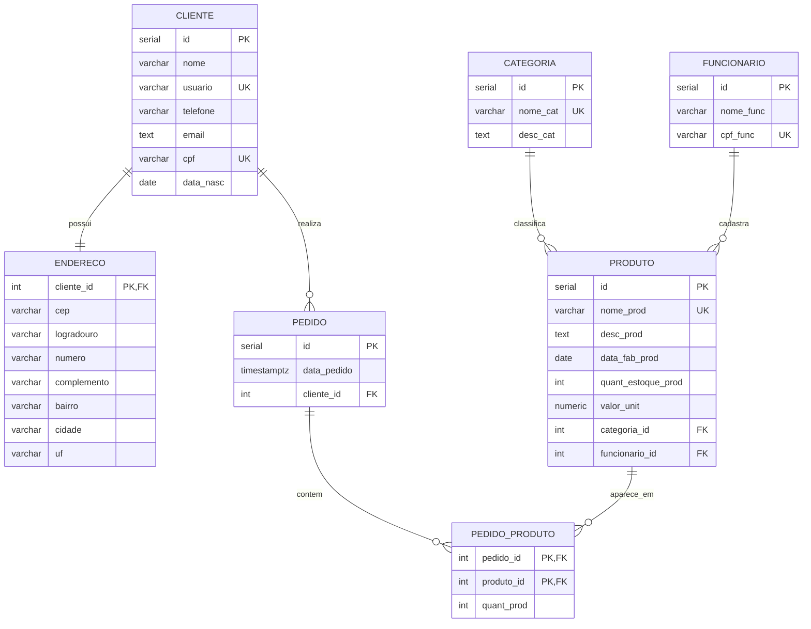

# Projeto Final — Banco de Dados (E-commerce)


Modelagem e implementação de um banco de dados relacional para um **e-commerce tradicional** (Opção 1 do trabalho final da disciplina de **Banco de Dados** — Residência Serratec).

O projeto inclui:

- Script completo de criação de tabelas, função/trigger, inserção de dados e consultas;
- Diagrama ER no formato do **pgModeler** (`erd_projetofinalbd.pgerd`);
- Enunciado do trabalho em PDF;
- Consultas com `JOIN`, `GROUP BY`, `COUNT` e construção de **nota fiscal** com window functions.

---

## Sumário

- [Contexto do trabalho](#contexto-do-trabalho)
- [Modelo de dados](#modelo-de-dados)
- [Estrutura do repositório](#estrutura-do-repositório)
- [Pré-requisitos](#pré-requisitos)
- [Como executar](#como-executar)
- [O que o script faz](#o-que-o-script-faz)
- [Consultas implementadas](#consultas-implementadas)
- [Regra de estoque (trigger)](#regra-de-estoque-trigger)
- [Decisões de modelagem](#decisões-de-modelagem)
- [Limitações e próximos passos](#limitações-e-próximos-passos)

---

## Contexto do trabalho

O enunciado descreve uma empresa de comércio varejista que vende produtos pela internet e precisa controlar **estoque**, **clientes**, **pedidos**, **categorias**, **funcionários** e emitir **nota fiscal**.

A opção escolhida foi a **Opção 1 — E-commerce tradicional**, em que a própria empresa produz e vende seus produtos (sem fornecedores externos).

Entidades obrigatórias segundo o enunciado: **Cliente, Pedido, PedidoItem, Produto, Categoria, NotaFiscal e Usuário**.

## Modelo de dados



### Tabelas

| Tabela | Descrição |
| --- | --- |
| `cliente` | Dados cadastrais do cliente |
| `endereco` | Endereço do cliente (relação 1:1) |
| `pedido` | Pedido realizado por um cliente |
| `pedido_produto` | Itens do pedido (N:N entre pedido e produto) |
| `produto` | Produto com estoque, valor e categoria |
| `categoria` | Categoria do produto |
| `funcionario` | Funcionário responsável pelo cadastro do produto |

> A **nota fiscal** não é uma tabela: ela é gerada por consulta SQL, conforme pedido no enunciado.

## Estrutura do repositório

```text
.
├── projetofinalbd.sql                     # Script principal (DDL + DML + queries)
├── erd_projetofinalbd.pgerd               # Diagrama ER (pgModeler)
└── Projeto final da disciplina de BD.pdf  # Enunciado do trabalho
```

## Pré-requisitos

- **PostgreSQL 15+** (versões anteriores também devem funcionar);
- Cliente `psql` no PATH **ou** uma ferramenta como DBeaver/pgAdmin;
- **pgModeler** (opcional, apenas para abrir o diagrama `.pgerd`).

## Como executar

### 1. Criar o banco

```bash
psql -U postgres -c "CREATE DATABASE projetofinalbd;"
```

Ou usando `createdb`:

```bash
createdb -U postgres projetofinalbd
```

### 2. Executar o script

```bash
psql -U postgres -d projetofinalbd -f projetofinalbd.sql
```

> ⚠️ **Formato de data**: os `INSERT`s usam datas no formato `DD/MM/AAAA` (ex.: `'22/08/2022'`). Dependendo do `DateStyle` do PostgreSQL, o script pode falhar com *“date/time field value out of range”*. Se isso acontecer, execute antes:
>
> ```sql
> SET datestyle = 'DMY';
> ```
>
> ou converta as datas para o formato ISO (`YYYY-MM-DD`).

### 3. Abrir o diagrama

Abra `erd_projetofinalbd.pgerd` no **pgModeler**.

## O que o script faz

1. **DDL** — cria as tabelas `cliente`, `endereco`, `pedido`, `funcionario`, `categoria`, `produto` e `pedido_produto`.
2. **Função + trigger** — `verificar_estoque_pedido()` impede inserir um item com quantidade maior que o estoque disponível.
3. **DML** — insere dados de exemplo:
   - 7 funcionários;
   - 5 categorias;
   - 6 produtos;
   - 5 clientes;
   - 5 endereços;
   - 5 pedidos;
   - 8 itens de pedido.
4. **Update** — altera o nome do funcionário de ID 7.
5. **Delete** — remove o funcionário de ID 7.
6. **Consultas** — joins, agregações e nota fiscal.

## Consultas implementadas

O script contém consultas que atendem aos requisitos do trabalho:

| Requisito | Consulta |
| --- | --- |
| Pelo menos 2 consultas com `JOIN` | `categoria LEFT JOIN produto` e `cliente JOIN endereco` |
| `COUNT()` + `GROUP BY` | Quantidade de produtos por categoria |
| `STRING_AGG` + `GROUP BY` | Clientes agrupados por UF |
| Nota fiscal | Consulta com todos os dados do pedido e `ROW_NUMBER()`/`SUM() OVER()` |
| Nota fiscal por pedido específico | Mesma consulta com `WHERE ped.id = 1` |

### Exemplo: produtos por categoria

```sql
SELECT
    c.nome_cat,
    COUNT(p.nome_prod)
FROM categoria c
LEFT JOIN produto p ON p.categoria_id = c.id
GROUP BY c.nome_cat;
```

### Exemplo: clientes por UF

```sql
SELECT
    STRING_AGG(c.nome, ', '),
    e.uf
FROM endereco e
JOIN cliente c ON c.id = e.cliente_id
GROUP BY e.uf;
```

### Nota fiscal

A consulta de nota fiscal retorna:

- Nome, e-mail, telefone e CPF do cliente;
- Endereço completo;
- Data do pedido;
- Produto, quantidade, valor unitário e valor total do item;
- Valor total do pedido (apenas na primeira linha de cada pedido, via `ROW_NUMBER()` + `SUM() OVER()`).

```sql
SELECT
    cl.nome,
    cl.email,
    cl.telefone,
    cl.cpf,
    e.cep,
    e.logradouro || ', ' || e.numero || ', ' || e.complemento AS endereco,
    e.bairro,
    e.cidade,
    e.uf,
    ped.data_pedido,
    prod.nome_prod,
    ped_prod.quant_prod AS quantidade_produtos,
    prod.valor_unit AS valor_produto,
    ped_prod.quant_prod * prod.valor_unit AS valor_total_produto,
    CASE WHEN ROW_NUMBER() OVER (PARTITION BY ped.id ORDER BY prod.id) = 1
         THEN SUM(ped_prod.quant_prod * prod.valor_unit) OVER (PARTITION BY ped.id)
    END AS valor_total_pedido
FROM cliente AS cl
INNER JOIN endereco e ON e.cliente_id = cl.id
INNER JOIN pedido AS ped ON cl.id = ped.cliente_id
INNER JOIN pedido_produto AS ped_prod ON ped.id = ped_prod.pedido_id
INNER JOIN produto AS prod ON ped_prod.produto_id = prod.id
ORDER BY ped.id, prod.id;
```

## Regra de estoque (trigger)

```sql
CREATE OR REPLACE FUNCTION verificar_estoque_pedido() RETURNS TRIGGER AS $$
BEGIN
    IF NEW.quant_prod > (SELECT quant_estoque_prod FROM produto WHERE id = NEW.produto_id) THEN
        RAISE EXCEPTION 'Não há estoque disponível suficiente para este produto.';
    END IF;
    RETURN NEW;
END;
$$ LANGUAGE plpgsql;

CREATE TRIGGER estoque_disponivel
BEFORE INSERT ON pedido_produto
FOR EACH ROW
EXECUTE FUNCTION verificar_estoque_pedido();
```

A trigger garante que nenhum item seja inserido com quantidade acima do estoque.

## Decisões de modelagem

- **Endereço separado** em tabela própria (1:1 com cliente), evitando repetição de campos;
- **`pedido_produto`** como tabela associativa com atributo `quant_prod`;
- **`funcionario`** representa o “usuário” do sistema que cadastra produtos;
- **Nota fiscal** gerada por consulta, sem tabela dedicada;
- Uso de `TIMESTAMPTZ` para a data do pedido, preservando fuso horário;
- Uso de `NUMERIC(100,2)` para valores monetários (evita erros de ponto flutuante).

## Limitações e próximos passos

- **Datas em `DD/MM/AAAA`** podem exigir `SET datestyle = 'DMY'` (ver observação acima).
- **Estoque não é decrementado** após a venda; a trigger apenas valida a quantidade no momento da inserção.
- **Sem constraint de unicidade** em `pedido_produto` além da chave composta — o mesmo produto não pode aparecer duas vezes no mesmo pedido, o que é aceitável para o modelo atual.
- **Sem tabela de nota fiscal** — a nota é apenas uma consulta.
- **Sem índices explícitos** além das chaves primárias/estrangeiras.
- **Dados de exemplo** incluem CPFs/e-mails fictícios.
- **Melhorias sugeridas**:
  - Criar procedure/trigger para baixar o estoque;
  - Adicionar tabela `nota_fiscal` com número, série e data de emissão;
  - Adicionar `CHECK` para quantidades e valores não negativos;
  - Normalizar telefone e CPF;
  - Criar índices para consultas por cliente e categoria.

## Contexto acadêmico

Trabalho final da disciplina de **Banco de Dados** — Residência de Software **Serratec**.

## Autor

Desenvolvido por **Rayan Ferraz** e equipe.

- GitHub: [@rayanferrazz](https://github.com/rayanferrazz)
